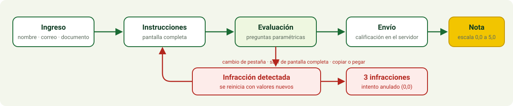

<div align="center">


<p>
  
  
  
  
</p>

<p><a href="README.md">Español</a> &nbsp;|&nbsp; <b>English</b></p>

</div>


## 📖 What it is

A web app for running **online quizzes** in the course **Manejo Integrado de Enfermedades** (Integrated Disease Management), taught by **Joaquín Guillermo Ramírez Gil** in the Department of Agronomy, Faculty of Agricultural Sciences, Universidad Nacional de Colombia, Bogotá campus. Built by **jf-floresriera** for the **Agrocomputation and Epidemiological Analysis Laboratory**.

It runs in any modern browser (desktop, tablet or phone), is **free software**, and needs no paid licences or services: a single Node.js server with no external dependencies.

| Need | How it is handled |
|---|---|
| Know who is taking the quiz | Sign-in with **full name**, **institutional email** (`@unal.edu.co`) and **ID number** |
| Keep answers the student's own | Copy, paste, print and tab switching are blocked; questions have **different values per student** |
| Assess more than memory | 9 question types, including interactive charts and simulators |
| Restart on cheating | Leaving the quiz in any way **restarts it** and is logged |
| Automate the process | Server-side grading, 0.0 to 5.0 scale, instructor panel and CSV export |


## 🚀 Quick start

You need **Node.js 18 or newer**. Nothing to install with `npm`.

```bash
git clone https://github.com/jf-floresriera/app_app.git
cd app_app
ADMIN_PASSWORD="a-long-password" npm start
```

Open <http://localhost:3000> for students and <http://localhost:3000/admin> for the instructor. Without `ADMIN_PASSWORD` the instructor panel is **disabled**. Run the automated tests with `npm test`.


## 🔄 Attempt flow

<div align="center">

</div>

1. The student signs in with the three fields. The first sign-in binds that email to the ID number; a different email for the same ID is rejected.
2. Pressing **Start** enters full screen (where the browser allows it) and starts the clock. The server owns the clock and it **never resets**.
3. Answers are saved automatically as the student types.
4. On submit, or when time runs out, the server grades. The student sees the grade and a **question-by-question review** with the correct answer and an explanation. If you give the quiz to several groups at different times, set `SHOW_FEEDBACK=false` so early takers cannot share answers; the instructor can always see them in `/admin`. Parametric questions have different values per student, so numeric answers cannot be copied.


## 🧩 Question types

| Type | What the student does | Grading |
|---|---|---|
| Single choice | Picks one option | All or nothing |
| Multiple choice | Ticks several options | Hits minus misses, over the number of correct options |
| True / false | Picks one of two | All or nothing |
| Parametric numeric | Computes with **values that change per student** (incidence, mean severity, AUDPC) | Correct within a tolerance |
| Short text | Types a word or short phrase | Matches an accepted-terms list, ignoring accents and case |
| Ordering | Orders the stages of the disease cycle with arrows | Share of correct positions |
| Matching | Pairs each pathogen with its disease | Share of correct pairs |
| Interactive chart | Clicks the day a disease progress curve crosses the action threshold | Correct within ±2 days |
| Simulator | Moves a fungicide application day and watches the curve and final severity | Exact = 1, one day early = 0.5 |

The bundled bank has **15 sample questions** (disease triangle, cultural control, pathosystems, disease cycle, quantification, epidemiology, genetic resistance, fungicide resistance management). The question texts are in Spanish.


## 🛡 Integrity controls

The student's browser detects; the server validates.

| Student action | Result |
|---|---|
| Switch tab, window or app | Violation and restart |
| Leave full screen | Violation and restart |
| Window loses focus | Violation and restart |
| Open dev tools (`F12`, `Ctrl+Shift+I/J/C`) or print (`Ctrl+P`, `Ctrl+S`) | Violation and restart |
| Sign in with the same data from another tab or browser | Old session is closed, the attempt restarts, one violation counted |
| Copy, cut, paste, drag, context menu, text selection | Blocked |
| Third violation (configurable) | Attempt annulled, grade 0.0 |

**What restart means:** answers are cleared, question and option order change, and parametric questions get new values. The remaining time is **not** reset.

### Limitations

A browser cannot guarantee that nobody uses another device. These measures **raise the cost** of cheating and **leave evidence**; they are not foolproof.

- A student can still consult an AI tool on **another device** (for example a second phone).
- `Ctrl+T` and `Alt+Tab` are not blocked; they are **detected** immediately and trigger a restart.
- iPhone browsers do not offer full screen; only tab switching and focus loss are monitored there.
- A system notification or a browser extension can steal focus and cause a violation. Ask students to close other apps and mute notifications.
- For high-stakes exams, run it **in a supervised room** or combine it with [Safe Exam Browser](https://safeexambrowser.org/) (free and open source).


## ⚙ Configuration

Environment variables only. See [`.env.example`](.env.example).

| Variable | Description | Default |
|---|---|---|
| `PORT` | Server port | `3000` |
| `ADMIN_PASSWORD` | Instructor panel password | unset (panel disabled) |
| `DURATION_MINUTES` | Quiz length | `30` |
| `MAX_VIOLATIONS` | Violations before annulment; `0` = unlimited | `3` |
| `ALLOWED_EMAIL_DOMAIN` | Accepted email domain | `unal.edu.co` |
| `SHOW_FEEDBACK` | `false` hides the correct answers from students after they finish | `true` |
| `DATA_DIR` | Folder where results are stored | `./data` |


## 👩‍🏫 Instructor panel

Open `/admin` and enter `ADMIN_PASSWORD`. It lists ID, name, email, status, grade, points, restarts, violations (hover for type and time), start and submit times; filters by name, email or ID; and shows the class average. **View answers** opens a per-student, question-by-question review (their answer, the correct one and an explanation). **Download CSV** includes one score column per question (0 to 1). **Reopen** deletes a student's attempt so they can retake the quiz, for example after an internet outage.


## ✏ Adding or changing questions

The bank lives in [`lib/questions.js`](lib/questions.js), in the `BANK` array:

```js
single('unique_id', 'Topic', 'Question text',
  [{ id: 'a', text: 'Option A' }, { id: 'b', text: 'Option B' }], 'b'),

trueFalse('another_id', 'Topic', 'Statement…', true),

multiple('id3', 'Topic', 'Select all…', [/* options */], ['a', 'c']),
```

Parametric, ordering, matching, chart and simulator questions use the `{ id, make(rng) }` form: copy an existing one (`incidencia`, `ciclo`, `patogenos`, `umbral_grafico`, `simulador_fungicida`). Always use `rng`, never `Math.random`, so each attempt is reproducible and the server can grade it. **Scientific names in italics:** wrap them in asterisks in any question or option text, e.g. `*Phytophthora infestans*` or `*Fusarium oxysporum* f. sp. *cubense*`. The browser renders them in italics. Correct answers live only on the server. Each question is worth 1 point; grade = `points / total × 5`.


## 🌐 Free deployment

The app must run Node.js; static hosting alone is not enough.

| Option | When it fits |
|---|---|
| **University or lab server** | Best option: data stays in the institution and the disk is persistent |
| **Any free-tier service that runs Node.js or Docker** | Tests and short quizzes. Check its current limits |
| **Your laptop on a local network** | In-room quiz: `npm start` and share the machine's IP |

```bash
docker build -t quiz-mie .
docker run -p 3000:3000 -e ADMIN_PASSWORD="a-long-password" -v quiz-data:/data quiz-mie
```

- Always serve over **HTTPS** to protect students' personal data in transit.
- Many free plans have an **ephemeral disk**: `data/results.json` is lost on restart. **Download the CSV** after each quiz, or use a persistent volume.


## 🎨 Visual identity

The UI uses the **green and yellow** palette of the Faculty of Agricultural Sciences and the Agrocomputation Laboratory. The colours are **approximate**: they were chosen without access to the brand manual or the logo file.

To match the official logo: replace [`public/img/logo-agrocomputacion.svg`](public/img/logo-agrocomputacion.svg) (keep the file name), edit the colour variables at the top of [`public/styles.css`](public/styles.css), and update [`assets/banner.svg`](assets/banner.svg) if you want this README to match.


## 🔒 Security and personal data

- Correct answers and seeds never leave the server; questions are regenerated from a per-attempt seed.
- The server is the authority for the clock, violations and grade.
- `Content-Security-Policy`, `X-Frame-Options: DENY` and `nosniff` headers; no external resources (no CDN, fonts or analytics).
- The instructor password is compared in constant time and never stored in code.
- CSV export neutralises cells starting with `=`, `+`, `-` or `@` to prevent spreadsheet formula injection.
- **Name, email and ID number** are stored in `DATA_DIR/results.json`. This is personal data (Colombian Law 1581 of 2012): tell students how it is used, restrict access to the file, and delete it when no longer needed. It is already in `.gitignore`.


## 👥 Credits

| Role | Person |
|---|---|
| Course instructor | Joaquín Guillermo Ramírez Gil |
| Development | [jf-floresriera](https://github.com/jf-floresriera) |
| Unit | Agrocomputation and Epidemiological Analysis Laboratory, Department of Agronomy, Faculty of Agricultural Sciences, Universidad Nacional de Colombia, Bogotá |

## 📄 License

[MIT](LICENSE). Free to use, copy and modify.
