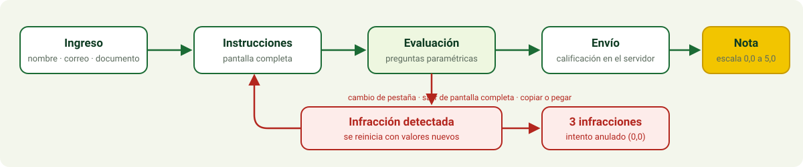

<div align="center">


<p>
  
  
  
  
</p>

<p><b>Español</b> &nbsp;|&nbsp; <a href="README.en.md">English</a></p>

</div>


## 📖 Qué es

Aplicación web para aplicar **exámenes en línea** (incluye un examen de prueba de **Manejo Integrado de Enfermedades**) del profesor **Joaquín Guillermo Ramírez Gil**, del Departamento de Agronomía, Facultad de Ciencias Agrarias, Universidad Nacional de Colombia, sede Bogotá. Fue desarrollada por **jf-floresriera** para el **Laboratorio de Agrocomputación y Análisis Epidemiológico**.

Funciona en cualquier navegador moderno (computador, tableta o celular), es **software libre** y no requiere pagar licencias ni servicios: es un único servidor Node.js sin dependencias externas.

| Necesidad | Cómo la resuelve |
|---|---|
| Saber quién presenta | Ingreso con **nombre completo**, **correo institucional** (`@unal.edu.co`) y **documento** |
| Que la respuesta sea del estudiante | Bloqueo de copiar, pegar, imprimir y cambiar de pestaña; preguntas con **valores distintos por estudiante** |
| Evaluar más que memoria | 9 tipos de pregunta, incluidos gráficos y simuladores interactivos |
| Reiniciar si hay trampa | Cualquier salida de la evaluación **la reinicia** y queda registrada |
| Automatizar el proceso | Calificación en el servidor, nota de 0,0 a 5,0, panel del profesor y exportación a CSV |


## 🚀 Inicio rápido

Necesita **Node.js 18 o superior**. No hay nada que instalar con `npm`.

```bash
# 1. Obtener el código
git clone https://github.com/jf-floresriera/app_app.git
cd app_app

# 2. Definir la clave del profesor y arrancar
ADMIN_PASSWORD="una-clave-larga" npm start
```

Abra <http://localhost:3000> para los estudiantes y <http://localhost:3000/admin> para el profesor.

Si no define `ADMIN_PASSWORD`, el panel del profesor queda **desactivado**.

Para correr las pruebas automáticas:

```bash
npm test
```


## 🔄 Flujo de un intento

<div align="center">

</div>

1. El estudiante ingresa con sus tres datos. El primer ingreso registra su correo para ese documento; un correo distinto con el mismo documento se rechaza.
2. Al pulsar **Comenzar** se activa la pantalla completa (donde el navegador lo permite) y arranca el reloj. El reloj lo controla el servidor y **nunca se reinicia**.
3. Las respuestas se guardan automáticamente mientras escribe.
4. Al enviar, o al agotarse el tiempo, el servidor califica. El estudiante ve **solo su nota**. La retroalimentación (respuesta correcta y explicación de cada pregunta) queda **oculta** hasta que el profesor la libere con un botón en `/admin`, normalmente cuando todos los grupos terminaron. Desde ese momento, quien ya envió la ve al volver a ingresar. Las preguntas paramétricas tienen valores distintos por estudiante, así que sus respuestas numéricas no se pueden copiar.


## 🧩 Tipos de pregunta

| Tipo | Qué hace el estudiante | Calificación |
|---|---|---|
| Selección única | Elige una opción | Todo o nada |
| Selección múltiple | Marca varias opciones | Aciertos menos errores, sobre el total correcto |
| Verdadero / falso | Elige una de dos | Todo o nada |
| Numérica paramétrica | Calcula con **valores que cambian por estudiante** (incidencia, severidad media, AUDPC) | Correcta dentro de una tolerancia |
| Respuesta escrita | Escribe una palabra o frase corta | Coincide con una lista de términos aceptados, sin importar tildes ni mayúsculas |
| Ordenar | Ordena las etapas del ciclo de la enfermedad con flechas | Proporción de posiciones correctas |
| Relacionar | Une cada patógeno con su enfermedad | Proporción de parejas correctas |
| Gráfico interactivo | Hace clic en una curva de progreso de la enfermedad en el día en que cruza el umbral de acción | Correcta dentro de ±2 días |
| Simulador | Mueve el día de aplicación de un fungicida y observa la curva y la severidad final | Exacto = 1, un día antes = 0,5 |

El banco incluido tiene **15 preguntas** de ejemplo sobre el triángulo de la enfermedad, control cultural, patosistemas, ciclo de la enfermedad, cuantificación, epidemiología, resistencia genética y manejo de resistencia a fungicidas.


## 🛡 Control de integridad

Todo lo que sigue lo hace el navegador del estudiante y lo valida el servidor.

| Acción del estudiante | Qué ocurre |
|---|---|
| Cambiar de pestaña, ventana o aplicación | Infracción y reinicio |
| Salir de la pantalla completa | Infracción y reinicio |
| Perder el foco de la ventana | Infracción y reinicio |
| Abrir las herramientas del navegador (`F12`, `Ctrl+Shift+I/J/C`) o imprimir (`Ctrl+P`, `Ctrl+S`) | Infracción y reinicio |
| Ingresar con los mismos datos desde otra pestaña o navegador | La sesión anterior se cierra, el intento se reinicia y cuenta una infracción |
| Copiar, cortar, pegar, arrastrar, menú contextual, seleccionar texto | Bloqueado |
| Tercera infracción (configurable) | Intento anulado con nota 0,0 |

**Qué significa reiniciar:** se borran las respuestas, cambia el orden de las preguntas y de las opciones, y las preguntas paramétricas reciben valores nuevos. El tiempo restante **no** se restablece.

### Limitaciones

Un navegador no puede garantizar que nadie use otro dispositivo. Estas medidas **dificultan** y **dejan evidencia**, pero no son infalibles:

- **Capturas de pantalla:** ningún sitio web puede bloquearlas. La aplicación detecta `PrintScreen`, `Win+Shift+S` y `Cmd+Shift+3/4/5`, oculta el contenido al perder el foco y reinicia el intento. Además muestra el **nombre y documento del estudiante como marca de agua** sobre toda la pantalla, de modo que cualquier captura o foto queda identificada. No se pueden detectar las capturas hechas con el celular, ni las fotos a la pantalla desde otro aparato.
- No se puede impedir que un estudiante use **otro dispositivo** (por ejemplo, un segundo celular) para consultar una herramienta de IA.
- Abrir una pestaña con `Ctrl+T` o cambiar con `Alt+Tab` no se bloquea; se **detecta** de inmediato y reinicia.
- En iPhone el navegador no permite pantalla completa; allí solo se vigilan el cambio de pestaña y la pérdida de foco.
- Una notificación del sistema o una extensión del navegador pueden quitar el foco y generar una infracción. Avise a los estudiantes que cierren otras aplicaciones y silencien notificaciones.
- Si la evaluación tiene un peso alto, aplíquela **presencial en sala** o use [Safe Exam Browser](https://safeexambrowser.org/) (libre y gratuito) junto con esta aplicación.


## 🔐 Examen privado: las respuestas no van a GitHub

Este repositorio es **público**: el banco de ejemplo de `lib/questions.js` y sus respuestas las puede leer cualquiera. **El examen real no debe subirse aquí.** La aplicación lo carga desde una variable de entorno privada del hosting, que nunca pasa por Git.

1. Escriba el examen en un archivo `examen.private.json` (el `.gitignore` lo excluye). El formato está en [`examples/examen-ejemplo.json`](examples/examen-ejemplo.json) y admite: `single`, `multiple`, `truefalse`, `numeric`, `text`, `ordering`, `matching`, y las preguntas con gráfico y simulador mediante `{ "builtin": "umbral_grafico" }`, `{ "builtin": "simulador_fungicida" }`, `{ "builtin": "incidencia" }`, `{ "builtin": "severidad" }` o `{ "builtin": "audpc" }`.
2. Valídelo y conviértalo:
   ```bash
   node scripts/preparar-examen.js examen.private.json
   ```
   Si hay un error, indica en qué pregunta. Genera `examen.private.b64.txt`.
3. En el hosting (Render: **Environment → Add variable**), cree `QUESTIONS_JSON_B64` y pegue el contenido de ese `.b64.txt`.
4. Al arrancar, el servidor imprime `Banco de preguntas: PRIVADO (N preguntas)`.

Dentro de un texto, `*así*` produce cursiva (nombres científicos). Si `QUESTIONS_JSON_B64` no existe, se usa el banco de ejemplo.

**Quién ve las respuestas correctas:** los estudiantes nunca las reciben durante el intento. Después de enviar ven solo su nota. El profesor las ve en `/admin` (**Ver respuestas**) y decide cuándo liberarlas con **Liberar a los estudiantes**.

Para más protección, haga el repositorio **privado** (GitHub → Settings → Danger Zone → Change visibility). Render puede seguir desplegándolo si autoriza el acceso.


## 🗂 Dos exámenes en la misma aplicación

| Ruta | Examen | Visibilidad |
|---|---|---|
| `/prueba` | **Examen de prueba**: el banco de ejemplo de Manejo Integrado de Enfermedades (`lib/questions.js`) | Público. La retroalimentación se ve siempre, para que los estudiantes practiquen y comprueben su equipo |
| `/` | **Examen vigente**: el que se carga de forma privada con `QUESTIONS_JSON_B64` | Privado. La retroalimentación la libera el profesor |

Si no se define `QUESTIONS_JSON_B64`, la ruta `/` abre el examen de prueba. Cada examen tiene sus propios intentos, notas, tiempo y retroalimentación, y un estudiante puede presentar ambos sin que se interfieran. En `/admin` el selector **Examen** cambia entre los dos (resultados, CSV, reabrir intento y liberar retroalimentación).

Campos opcionales del archivo del examen privado: `title` (título en la barra superior), `course`, `intro` (lista de instrucciones que se muestran antes de comenzar), `durationMinutes` (duración propia; si falta, se usa `DURATION_MINUTES`) y `shuffleQuestions` (`false` mantiene el orden de las preguntas; las opciones siempre se barajan). En las preguntas de relacionar, `distractors` agrega opciones que no tienen pareja. Fórmulas y símbolos (R₀, ⟨k²⟩, √φ, β₁) se escriben tal cual en Unicode; use `∗` en lugar de `*` dentro de una fórmula, porque el asterisco normal marca la cursiva.


## ⚙ Configuración

Todo se define con variables de entorno. Hay un ejemplo en [`.env.example`](.env.example).

| Variable | Descripción | Por defecto |
|---|---|---|
| `PORT` | Puerto del servidor | `3000` |
| `ADMIN_PASSWORD` | Clave del panel del profesor | sin definir (panel desactivado) |
| `DURATION_MINUTES` | Duración del examen cuando el examen no define la suya | `30` |
| `MAX_VIOLATIONS` | Infracciones antes de anular el intento; `0` = ilimitadas | `3` |
| `ALLOWED_EMAIL_DOMAIN` | Dominio aceptado para el correo | `unal.edu.co` |
| `SHOW_FEEDBACK` | `true` hace que la retroalimentación nazca visible. Normalmente se deja en `false` y el profesor la libera desde `/admin` | `false` |
| `DATA_DIR` | Carpeta donde se guardan los resultados | `./data` |


## 👩‍🏫 Panel del profesor

Entre a `/admin` con la clave `ADMIN_PASSWORD`.

- Tabla con documento, nombre, correo, estado, nota, puntos, reinicios, infracciones, hora de inicio y de envío. Pase el cursor sobre las infracciones para ver su tipo y hora.
- Filtro por nombre, correo o documento, y promedio del curso.
- **Liberar a los estudiantes / Ocultar de nuevo** controla si los estudiantes ven la retroalimentación. Empieza oculta.
- **Ver respuestas** abre, para cada estudiante, la revisión pregunta por pregunta: lo que respondió, la respuesta correcta y una explicación.
- **Descargar CSV** con una columna de puntaje por pregunta (0 a 1), pensado para abrir en Excel o cargar en R o Python.
- **Reabrir** borra el intento de un estudiante para que pueda presentar de nuevo (por ejemplo, tras un corte de internet).


## ✏ Agregar o cambiar preguntas

El banco está en [`lib/questions.js`](lib/questions.js), en el arreglo `BANK`. Cada pregunta se declara con un constructor:

```js
single(
  'id_unico', 'Tema',
  'Texto de la pregunta',
  [{ id: 'a', text: 'Opción A' }, { id: 'b', text: 'Opción B' }],
  'b',                       // id de la opción correcta
),

trueFalse('otro_id', 'Tema', 'Afirmación…', true),

multiple('id3', 'Tema', 'Seleccione todas…', [/* opciones */], ['a', 'c']),
```

Las preguntas paramétricas, ordenar, relacionar, gráficos y simuladores usan la forma `{ id, make(rng) }`; copie una de las existentes (`incidencia`, `ciclo`, `patogenos`, `umbral_grafico`, `simulador_fungicida`) y cambie los valores. Use siempre `rng` (nunca `Math.random`) para que cada intento sea reproducible y el servidor pueda calificar.

**Nombres científicos en cursiva:** enciérrelos entre asteriscos en cualquier texto de pregunta u opción, por ejemplo `*Phytophthora infestans*` o `*Fusarium oxysporum* f. sp. *cubense*`. El navegador los muestra en cursiva.

Las respuestas correctas viven solo en el servidor (`key`); el navegador nunca las recibe.

Cada pregunta vale 1 punto y la nota es `puntos / total × 5`.


## 🌐 Despliegue gratuito

La aplicación necesita ejecutar Node.js; no sirve alojarla solo como página estática. Opciones sin costo de licencia:

| Opción | Cuándo conviene |
|---|---|
| **Servidor de la universidad o del laboratorio** | Es la mejor opción: los datos quedan en la institución y el disco es persistente |
| **Cualquier servicio con plan gratuito que ejecute Node.js o Docker** | Para pruebas y exámenes cortos. Revise sus límites vigentes |
| **Su computador en una red local** | Examen presencial en sala: `npm start` y comparta la IP del equipo |

```bash
# Con Docker
docker build -t examen-app .
docker run -p 3000:3000 -e ADMIN_PASSWORD="una-clave-larga" -v examen-data:/data examen-app
```

**Importante:**

- Sirva siempre la aplicación por **HTTPS** (protege los datos personales de los estudiantes en tránsito). Un proxy como Nginx, Caddy o el del propio servicio de alojamiento lo resuelve.
- Muchos planes gratuitos tienen **disco efímero**: al reiniciarse el servicio se pierde `data/results.json`. **Descargue el CSV** al terminar cada examen, o use un volumen persistente.
- Si el servicio queda detrás de un proxy, los estudiantes de una misma red comparten dirección IP; la aplicación no limita por IP, solo por documento.


## 🎨 Identidad visual

La interfaz usa la paleta **verde y amarillo** de la Facultad de Ciencias Agrarias y del Laboratorio de Agrocomputación. Los colores son **aproximados**: se definieron sin acceso al manual de identidad ni al archivo del logotipo.

Para igualarlos al logotipo oficial:

1. Reemplace [`public/img/logo-agrocomputacion.svg`](public/img/logo-agrocomputacion.svg) por el logotipo del laboratorio (mantenga el nombre del archivo).
2. Edite las variables de color al inicio de [`public/styles.css`](public/styles.css) (`--green-*`, `--lime`, `--yellow`).
3. Actualice el banner de [`assets/banner.svg`](assets/banner.svg) si desea que coincida en este README.


## 🗂 Estructura

```text
.
├── server.js              # Servidor HTTP, sesiones, API, panel del profesor
├── lib/
│   └── questions.js       # Banco de preguntas, generación paramétrica y calificación
├── public/
│   ├── index.html         # Interfaz del estudiante
│   ├── app.js             # Lógica del cliente: preguntas, gráficos, antitrampas
│   ├── styles.css         # Estilos y paleta
│   ├── admin.html / .js   # Panel del profesor
│   └── img/               # Logotipo
├── test/flow.test.js      # Pruebas del flujo completo (node:test)
├── assets/                # Imágenes de este README
├── Dockerfile
├── .env.example
└── LICENSE
```


## 🔒 Seguridad y datos personales

- Las respuestas correctas y las semillas **no salen del servidor**; las preguntas se regeneran a partir de una semilla por intento.
- El servidor es la autoridad del reloj, de las infracciones y de la nota; el navegador solo informa.
- Cabeceras `Content-Security-Policy`, `X-Frame-Options: DENY` y `nosniff`; sin recursos externos (sin CDN, fuentes ni analítica).
- La clave del profesor se compara en tiempo constante y nunca se guarda en el código.
- El CSV neutraliza celdas que empiezan con `=`, `+`, `-` o `@` para evitar fórmulas maliciosas en Excel.
- Se almacenan **nombre, correo y documento** en `DATA_DIR/results.json`. Son datos personales (Ley 1581 de 2012, habeas data): informe a los estudiantes para qué se usan, restrinja el acceso a ese archivo y bórrelo cuando deje de ser necesario. No incluya el archivo en el repositorio (ya está en `.gitignore`).


## 👥 Créditos

| Rol | Persona |
|---|---|
| Profesor de la asignatura | Joaquín Guillermo Ramírez Gil |
| Desarrollo | [jf-floresriera](https://github.com/jf-floresriera) |
| Unidad | Laboratorio de Agrocomputación y Análisis Epidemiológico, Departamento de Agronomía, Facultad de Ciencias Agrarias, Universidad Nacional de Colombia, sede Bogotá |

## 📄 Licencia

[MIT](LICENSE). Puede usar, copiar y modificar la aplicación sin costo.
